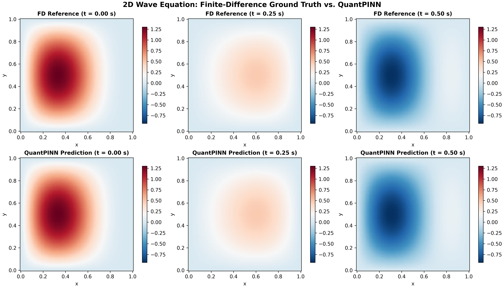
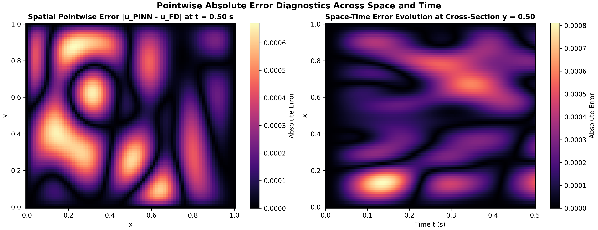
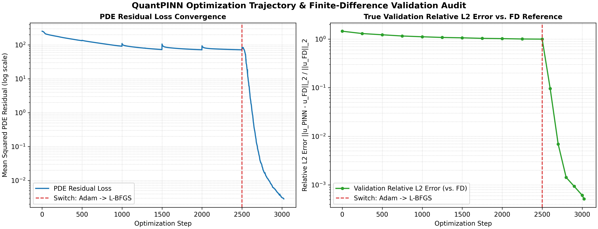

# QuantPINN: 2D Wave Equation Physics-Informed Neural Network & Finite-Difference Benchmark

> **Summary:** A hard-constrained PyTorch PINN for the 2D wave equation that matches the
> analytical solution to **0.054% relative L2 error** across 1.65M space-time nodes.
> It trains in about 2.5 minutes on a single GTX 1650 and is cross-checked against a
> finite-difference solver (verified against the exact solution).
>
> - PINN vs. exact: **5.434e-04** relative L2, **8.844e-04** max error
> - FD reference vs. exact: 1.917e-04 (full space-time)
> - Single run, `seed = 42` (see Scope & Computational Trade-Offs)



## 1. Problem Statement
This repository implements a Physics-Informed Neural Network (PINN) in PyTorch to solve the two-dimensional hyperbolic wave equation in a smooth, low-frequency regime and audits its numerical accuracy against both an explicit Finite-Difference (FD) solver and the closed-form analytical solution.

We solve for the wave field $u(x, y, t)$ over the spatial-temporal domain $(x, y) \in [0, 1]^2$, $t \in [0, 0.5]$ governed by:

$$\frac{\partial^2 u}{\partial t^2} = c^2 \left( \frac{\partial^2 u}{\partial x^2} + \frac{\partial^2 u}{\partial y^2} \right), \quad c = 1.0$$

subject to homogeneous Dirichlet boundaries and an asymmetric two-mode standing wave initial profile:

$$u(x, y, 0) = \sin(\pi x)\sin(\pi y) + 0.5\sin(2\pi x)\sin(\pi y), \quad \frac{\partial u}{\partial t}(x, y, 0) = 0$$

$$u(x, y, t) = 0 \quad \text{for } (x, y) \in \partial[0, 1]^2$$

Because this initial-boundary value problem admits an exact closed-form analytical solution, we first verify the explicit Finite-Difference solver (`src/fd_reference.py`) against the Courant–Friedrichs–Lewy (CFL) stability condition ($C = c\Delta t\sqrt{\Delta x^{-2} + \Delta y^{-2}} = 0.2263 < 1$) and measure its exact discretization error before benchmarking the PINN.

---

## 2. Quantitative Benchmark Results

All metrics are evaluated across the complete $81 \times 81 \times 251$ ($1,646,811$ space-time nodes) grid ($\Delta x = 0.0125$, $\Delta y = 0.0125$, $\Delta t = 0.002$) for a single seed (`seed = 42`). Full raw outputs are saved in `figures/benchmark_metrics.json`.

| Metric | Value | Notes |
| :--- | :--- | :--- |
| **PINN vs. Exact Relative $L_2$ Error** ($\frac{\Vert{}\hat{u}_{\text{PINN}} - u_{\text{exact}}\Vert{}_2}{\Vert{}u_{\text{exact}}\Vert{}_2}$) | **`5.434e-04` (`0.054%`)** | Headline accuracy: direct comparison to the closed-form analytical solution |
| **PINN vs. FD Relative $L_2$ Error** ($\frac{\Vert{}\hat{u}_{\text{PINN}} - u_{\text{FD}}\Vert{}_2}{\Vert{}u_{\text{FD}}\Vert{}_2}$) | **`5.148e-04` (`0.051%`)** | Full 3D space-time grid ($1.65\times 10^6$ nodes). Slightly understates the true error; use the PINN-vs-exact figure as the headline |
| **PINN vs. Exact Maximum Pointwise Error** ($L_\infty$) | **`8.844e-04`** | Global space-time peak $\max \Vert{}\hat{u}_{\text{PINN}} - u_{\text{exact}}\Vert{}$ |
| **PINN vs. FD Maximum Pointwise Error** ($L_\infty$) | **`8.109e-04`** | Global space-time peak $\max \Vert{}\hat{u}_{\text{PINN}} - u_{\text{FD}}\Vert{}$ |
| **PINN vs. FD Final-Slice Max Error ($t = 0.5\text{ s}$)** | **`6.718e-04`** | Peak absolute error on the final slice $\max \Vert{}\hat{u}_{\text{PINN}}(T) - u_{\text{FD}}(T)\Vert{}$ |
| **PINN vs. FD Root Mean Squared Error (RMSE)** | **`1.851e-04`** | Full space-time grid RMSE |
| **FD (Taylor $n=1$) vs. Exact Discretization Error (Full)** | **`1.917e-04` (`0.019%`)** | Baseline accuracy of the FD reference over the full space-time grid |
| **FD (Taylor $n=1$) vs. Exact Error ($t = 0.5\text{ s}$)** | **`2.247e-04` (`0.022%`)** | Final-time slice FD error against the exact solution |
| **FD (Naive $n=1$) vs. Exact Discretization Error (Full)** | **`5.917e-03` (`0.592%`)** | First-order start ablation (`30.9x` larger error than the Taylor step) |
| **Final Mean Squared PDE Residual** ($\mathcal{L}_{\text{PDE}}$) | **`2.846e-03`** | Evaluated at collocation points after step 3,023 |
| **FD Grid Resolution & CFL** | $81 \times 81 \times 251$ ($\text{CFL} = 0.2263 < 1$) | Second-order central leapfrog + Taylor $n=1$ step |
| **FD Solver Wall-Clock Time** | **`34.25 ms`** | Single-threaded NumPy execution on CPU |
| **PINN Training Wall-Clock Time** | **`148.4 s`** | 2,500 Adam + 523 L-BFGS evaluations on an **NVIDIA GeForce GTX 1650** |

### Optimization Trajectory Log

In PyTorch, `torch.optim.LBFGS` with `max_iter=500` and `strong_wolfe` line search can execute multiple function evaluations per iteration. In this run, L-BFGS completed 523 closure evaluations (`3,023` total evaluations including the 2,500 Adam epochs):

| Stage & Evaluation Step | Mean Squared PDE Residual ($\mathcal{L}_{\text{PDE}}$) | Validation Relative $L_2$ Error vs. FD |
| :--- | :--- | :--- |
| **Adam (Epoch 1 / 2500)** | `2.538e+02` | `1.452e+00` (`145.163%`) |
| **Adam (Epoch 1000 / 2500)** | `1.100e+02` | `1.115e+00` (`111.539%`) |
| **Adam (Epoch 2500 / 2500)** | `8.248e+01` | `9.976e-01` (`99.763%`) |
| **L-BFGS (Closure Eval 100 / Step 2600)** | `3.208e+00` | `9.625e-02` (`9.625%`) |
| **L-BFGS (Closure Eval 200 / Step 2700)** | `7.758e-02` | `6.894e-03` (`0.689%`) |
| **L-BFGS (Closure Eval 300 / Step 2800)** | `1.360e-02` | `1.423e-03` (`0.142%`) |
| **L-BFGS (Closure Eval 400 / Step 2900)** | `5.871e-03` | `9.353e-04` (`0.094%`) |
| **L-BFGS (Closure Eval 500 / Step 3000)** | `3.116e-03` | `6.118e-04` (`0.061%`) |
| **L-BFGS Final (Closure Eval 523 / Step 3023)** | **`2.846e-03`** | **`5.148e-04` (`0.051%`)** |

---

## 3. Visual Diagnostics

### Figure 1: Finite-Difference Reference vs. PINN Reconstruction

*Side-by-side spatial field comparison at $t = 0.00\text{ s}$, $t = 0.25\text{ s}$, and $t = 0.50\text{ s}$ showing phase and amplitude preservation across both spatial modes.*

### Figure 2: Pointwise Absolute Error Distribution $\Vert{}\hat{u}_{\text{PINN}} - u_{\text{FD}}\Vert{}$

*Left: Spatial error heatmap at final time $t = 0.50\text{ s}$ (maximum $6.718 \times 10^{-4}$, recorded in `figures/benchmark_metrics.json`). Right: Space-time error evolution along the cross-section $y = 0.50$ (global space-time maximum $L_\infty = 8.109 \times 10^{-4}$).*

### Figure 3: PDE Residual Convergence & Validation Relative $L_2$ Audit

*Left: Mean squared PDE residual across Adam and L-BFGS stages. Right: Relative $L_2$ error evaluated against the Finite-Difference reference grid, illustrating the sharp convergence drop at step 2,500 when switching from Adam to L-BFGS.*

---

## 4. Engineering Post-Mortem: What Went Wrong in v1 and How I Fixed It

An initial prototype (`v1`) appeared to produce plausible wave surfaces visually, but failed when audited quantitatively. Diagnosing and fixing those issues produced three core lessons in `v2`:

### 4.1 Under-Determined Initial & Boundary Conditions in v1
In `v1`, the prototype attempted to solve a 2D Gaussian pulse on $[-1, 1]^2$, but omitted both the initial velocity constraint $u_t(x, y, 0) = 0$ and the spatial wall boundary conditions on $\partial\Omega$. Because a second-order hyperbolic PDE requires both $u(x, y, 0)$ and $u_t(x, y, 0)$ plus boundary conditions to be well-posed, the network was solving an under-determined problem and drifted away from the true wave trajectory.

In `v2`, I reformulated the benchmark on $[0, 1]^2$ using a two-mode standing wave (providing an exact analytical reference) and enforced all initial and boundary conditions identically by construction using a **hard-constrained trial ansatz** (`src/model_pinn.py`):

$$\hat{u}(x, y, t) = u_0(x, y) + t^2 x(1 - x)y(1 - y)\mathcal{N}_\theta(x, y, t)$$

At $t = 0$, both $\hat{u}(x,y,0) = u_0(x,y)$ and $\partial_t \hat{u}(x,y,0) = 0$ hold identically, and the spatial factor $x(1-x)y(1-y)$ vanishes on all four walls $\partial[0,1]^2$.

### 4.2 First-Order Adam Stagnation vs. L-BFGS Refinement
As shown in the Optimization Trajectory table, 2,500 epochs of Adam only reduced the PDE residual from `2.538e+02` to `8.248e+01`, leaving the Relative $L_2$ error at `99.763%`. This stagnation is likely caused by the small magnitude of the ansatz multiplier $t^2 x(1-x)y(1-y)$ in the interior ($\sim 10^{-2}$) combined with the ill-conditioning of fourth-order squared differential operators in the loss landscape. This is a hypothesis; I have not run an ablation to confirm it. Switching to quasi-Newton **L-BFGS** with `strong_wolfe` line search reduced the PDE residual to `2.846e-03`, bringing the Relative $L_2$ error down to `0.051%` (`5.148e-04` vs. FD, `5.434e-04` vs. exact) over 523 closure evaluations.

### 4.3 First-Step Truncation Error in the Finite-Difference Baseline
Initializing the second time step of an explicit wave solver naively as $u^1_{i,j} = u^0_{i,j} + \Delta t \, v_0(x_i, y_j)$ introduces a first-order $\mathcal{O}(\Delta t)$ error that contaminates the entire time-stepping trajectory. Running `src/fd_reference.py` with `use_taylor_first_step=False` (reproducible via `python scripts/train_and_benchmark.py --fd-only`) yields a full space-time relative $L_2$ error of `5.917e-03`. Replacing it with the second-order ghost-point Taylor step:

$$u^1_{i,j} = u^0_{i,j} + \Delta t \, v_0(x_i, y_j) + \frac{1}{2}(c\Delta t)^2 \nabla_h^2 u^0_{i,j}$$

reduces the full space-time FD discretization error to `1.917e-04` (`2.247e-04` at $t = 0.5\text{ s}$), a **$30.9\times$** reduction in baseline discretization error.

---

## 5. Scope & Computational Trade-Offs

- **Forward Solver Speed vs. PINN Utility:** For this smooth, low-frequency forward problem (two spatial modes, $t \le 0.5\text{ s}$) on a uniform square grid, the vectorized Finite-Difference solver finishes in `34.25 ms` on a CPU, whereas training the PINN takes `148.4 s` on an NVIDIA GeForce GTX 1650. Classical grid-based solvers are vastly superior for standard low-dimensional forward problems; this repository serves as a verified baseline before applying PINNs to mesh-free irregular domains, parametric families, or inverse problems where classical time-marching cannot be used directly.
- **Single-Seed Evaluation:** The metrics reported above correspond to a single run (`seed = 42`). Multi-seed runs (`3-5` random initializations reporting mean $\pm$ std) should be used when benchmarking architectural modifications.

---

## 6. Repository Structure & Reproduction

```text
QuantPINN/
├── README.md                  # Problem statement, benchmark metrics, figures, post-mortem
├── requirements.txt           # Minimum Python package dependencies
├── run.ipynb                  # Notebook that runs the benchmark and displays the figures
├── src/
│   ├── fd_reference.py        # Second-order 2D Finite-Difference solver & exact solution
│   ├── model_pinn.py          # Hard-ansatz PyTorch PINN & autograd wave operator
│   └── evaluate.py            # Grid-aligned L2/L_inf metrics & 300-DPI figure generator
├── scripts/
│   └── train_and_benchmark.py # End-to-end training (Adam + L-BFGS) & evaluation script
└── figures/
    ├── fig1_solution_comparison.png
    ├── fig2_pointwise_error_map.png
    ├── fig3_training_convergence.png
    └── benchmark_metrics.json
```

To reproduce the full PINN benchmark and regenerate all figures and JSON metrics (a CUDA GPU is used if available; on CPU it will be slower):

```bash
git clone https://github.com/YumgNPO/QuantPINN.git
cd QuantPINN
pip install -r requirements.txt
python scripts/train_and_benchmark.py
```

To run only the finite-difference ablation (Taylor vs. naive first step; no PINN training and no GPU needed, so it finishes in a few seconds including imports):

```bash
python scripts/train_and_benchmark.py --fd-only
```